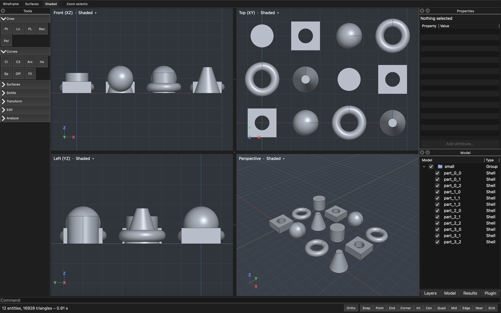
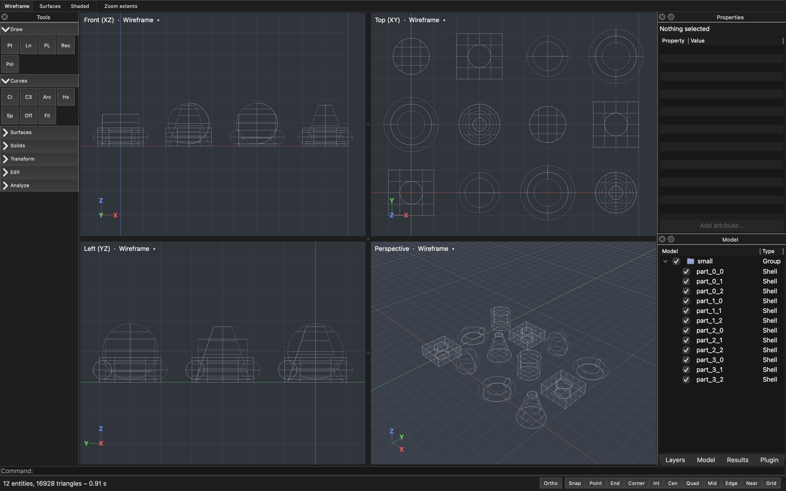
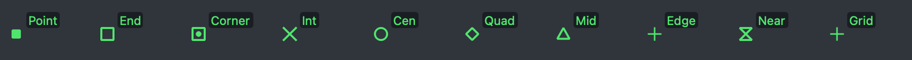
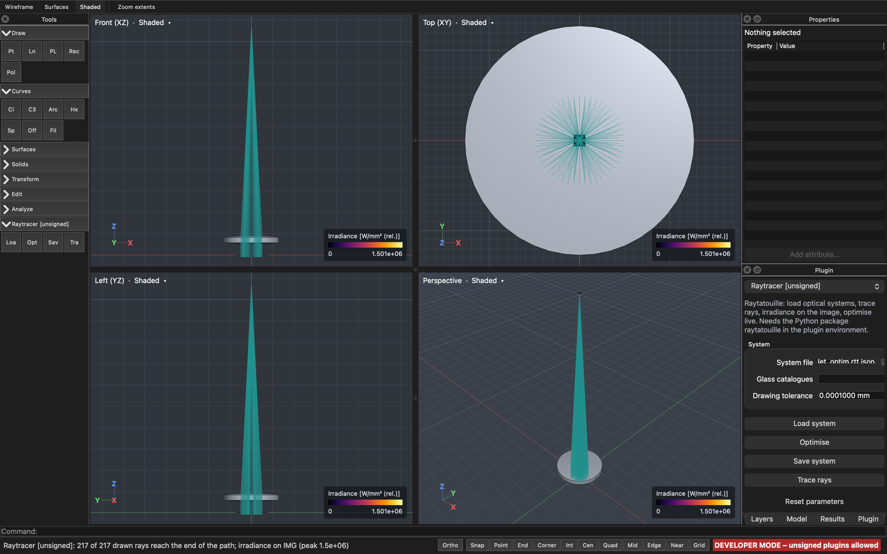
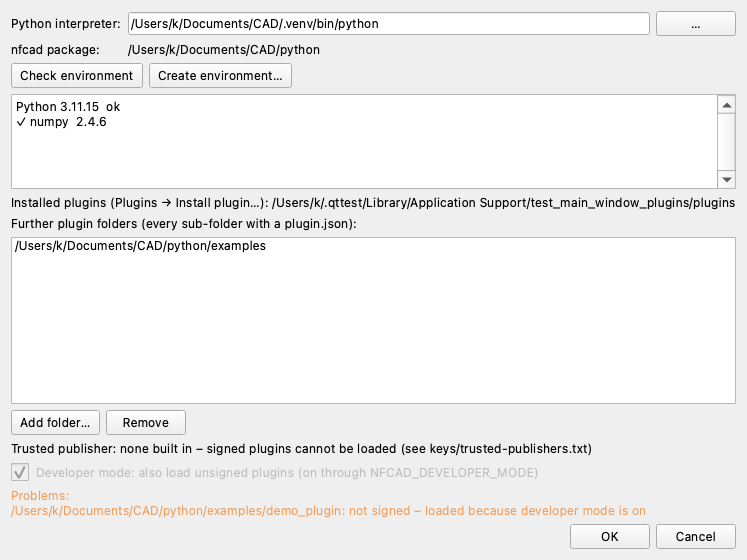

# User guide

Raytatouille Fusion is a CAD front end for the NURBS kernel
[Nurbforge](https://github.com/PhotonPower/Nurbforge) and the computation kernels built on it,
such as the ray tracer [Raytatouille](https://github.com/PhotonPower/Raytatouille). You model
or import geometry, run a kernel through a plugin and see its results on the model: rays as
lines, fields and images on faces, curves in a plot.

## Installing

| System | Package | Notes |
|---|---|---|
| macOS 14 or newer (Apple Silicon and Intel) | `RaytatouilleFusion-<version>-macos-universal.dmg` | The app is **not signed**: the first time, open it with right-click → *Open* (or allow it in *System Settings → Privacy & Security*). |
| Windows 11 | `RaytatouilleFusion-<version>-win64-setup.exe` | Installs per machine; updates replace older versions. |
| AlmaLinux / RHEL 10 | `raytatouille-fusion-<version>.x86_64.rpm` | `sudo dnf install ./raytatouille-fusion-*.rpm` (Qt from the distribution). |

Plugins run in **your** Python environment (3.10 or newer, with numpy and the kernel packages),
see [Plugins](#plugins).

## The main window

- **Tool column** (left): commands in collapsible groups – Draw, Curves, Surfaces, Solids,
  Transform, Edit, Analyze, and one group per plugin. Hover for name and shortcut.
- **Four views** (centre): Front (XZ), Left (YZ), Top (XY) and Perspective. The header of each
  view switches its display mode; **Space** maximises the view under the cursor and back.
- **Display modes** (toolbar): *Wireframe*, *Surfaces* (flat, with edges) and *Shaded*.
- **Docks** (right): *Properties* of the selection (also free attributes), *Layers*, *Model*
  tree (groups with visibility check boxes; right-click: group, hide, isolate, show all),
  *Results* of computations, *Plugin* (parameters and actions); *Plot* appears at the bottom
  with the first curve. Every dock can be moved, tabbed or hidden (*View* menu).
- **Command line** (bottom): type a command or coordinates; the prompt says what is expected.
- **Status bar**: coordinates, messages, *Ortho* and the snap toggles.

### Navigating

| Action | Mouse / keys |
|---|---|
| Orbit (perspective view) | right drag, or Alt + left drag |
| Pan | middle drag, Shift + right drag; trackpad: two-finger scroll |
| Zoom at the cursor | mouse wheel; trackpad: pinch or Cmd/Ctrl + scroll |
| Zoom extents | toolbar *Zoom extents*, **Z, E** or double-click with the middle button (active view); Shift + toolbar: all views |
| Maximise / restore a view | **Space** |

### Selecting

Click an object to select it (click into empty space clears), **Shift**-click adds,
**Cmd/Ctrl**-click removes, **Cmd/Ctrl + Shift**-click toggles a single face, edge or vertex.
Dragging a rectangle from left to right selects objects completely inside it, from right to
left also those touching it. The object under the cursor is highlighted in cyan, the selection
in yellow. **Esc** clears the selection (or first cancels the running command or plugin job).

## Drawing and modelling

Start a command from the tool column, by its shortcut, or by typing its name or alias. Input:

- **Points** with the mouse (with object snaps) or typed: `x,y,z`, `x,y` (in the construction
  plane), `@dx,dy,dz` relative to the last point, `d<a` as distance and angle.
- **Numbers** where a length, radius or count is expected.
- **Enter** or right-click finishes (e.g. a polyline); Enter with an empty command line repeats
  the last command. **F8** toggles *Ortho* (horizontal / vertical in the construction plane).

All commands with their input: [commands.md](commands.md). Every command is one undo step.

### Object snaps

The cursor snaps to points, ends, midpoints, centres, quadrants (where the axes of the
construction plane pierce circles), intersections, face corners and edges, and "near" any
curve. A glyph shows the type:

**Tab** cycles through all candidates under the cursor, **Alt** suppresses snapping while
held, **F3** switches all snaps off and on; each type has its own toggle in the status bar.
Details: [snapping.md](snapping.md).

## Files

| Format | Read | Write | Notes |
|---|---|---|---|
| `.nfcad` | ✓ | ✓ | the document: exact geometry, layers, groups, attributes, plugin parameters ([format](file-format.md)) |
| STEP | ✓ | ✓ (AP214) | opening replaces the document, *File → Import STEP…* adds to it; *File → Export STEP…* writes solids and surfaces exactly |
| STL | | ✓ | *File → Export STL…*: binary, from the display tessellation |

Example models are in [`examples/`](../examples/README.md).

## Plugins

Plugins connect computation kernels: they add a group to the tool column and a page to the
**Plugin** dock with their parameters and actions. Results appear in the *Results* dock (rays,
fields on faces) and the *Plot* dock; everything a plugin run changes in the model is **one
undo step**.

**Setting up** (*Plugins → Settings…*):

1. **Python interpreter** – an environment with the kernel's packages. *Check environment*
   shows what the installed plugins need and what is missing (with the `pip` command);
   *Create environment…* makes a new venv.
2. **Installing plugins** – *Plugins → Install plugin…* with a `.nfplugin` file, or open the
   file with the application. *Plugins → Uninstall plugin* removes it.
3. **Signatures** – only plugins signed by the publisher whose key is built into the
   application are loaded. *Developer mode* also loads unsigned plugins (for plugin
   developers); a red banner in the status bar shows that it is on.

The **Raytracer** plugin (Raytatouille) loads `.rtt.json` optical systems, traces rays, shows
the irradiance on the image surface and optimises with live updates – see its
[guide](../python/plugins/raytracer/README.md). Writing your own plugins:
[plugin-api.md](plugin-api.md).

## Updates, crashes, settings

- *Help → Check for updates…* compares with the latest release and with the plugins' update
  information – only when you choose it.
- If the application crashes, it writes a **crash report on this computer** (nothing is sent)
  and points to it at the next start; attach it when you report the problem on
  [GitHub](https://github.com/PhotonPower/Raytatouille-Fusion/issues).
- Settings (window layout, tool column, snaps, plugin settings) are kept across updates;
  those of the former *Nurbforge CAD* are taken over once.

## Keyboard shortcuts

| Keys | Action |
|---|---|
| Ctrl/Cmd + N, O, S, Shift + S | new, open, save, save as |
| Ctrl/Cmd + I | import STEP |
| Ctrl/Cmd + Z, Shift + Ctrl/Cmd + Z | undo, redo |
| Ctrl/Cmd + A | select all |
| Delete / Backspace | delete the selection |
| Ctrl/Cmd + G, Shift + Ctrl/Cmd + G | group, ungroup |
| Esc | cancel the command / plugin job, else clear the selection |
| Enter | finish the command; on an empty command line: repeat the last one |
| Space | maximise / restore the view under the cursor |
| Z, E | zoom extents (active view) |
| F3 | object snaps on / off |
| F8 | ortho on / off |
| Tab / Shift + Tab | next / previous snap candidate |
| Alt (held) | no snapping |
| L, C, M | line, circle, move (more in the tooltips of the tool column) |
